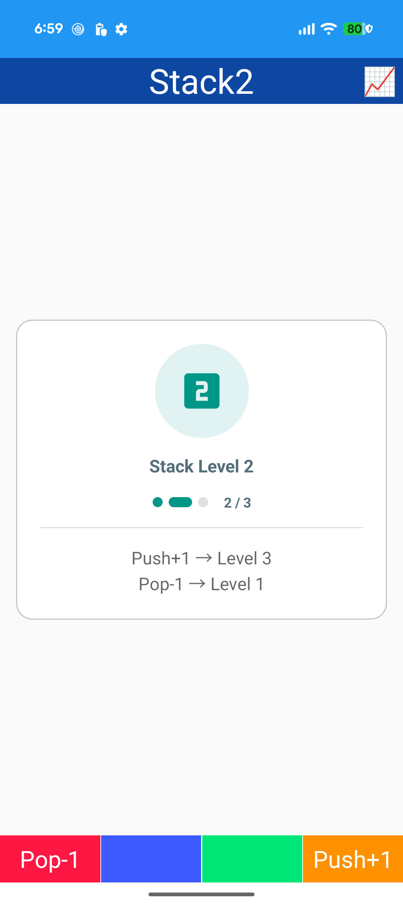
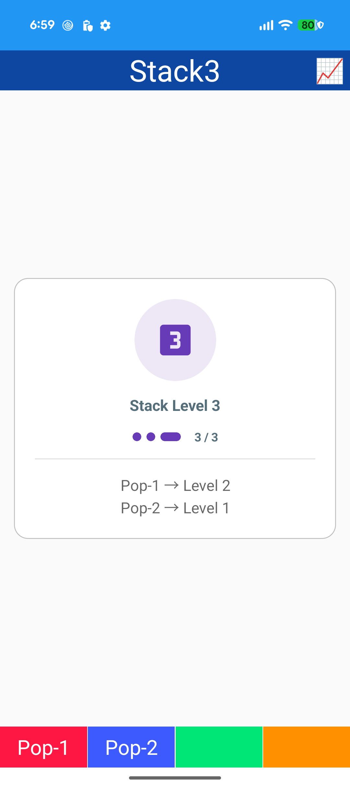
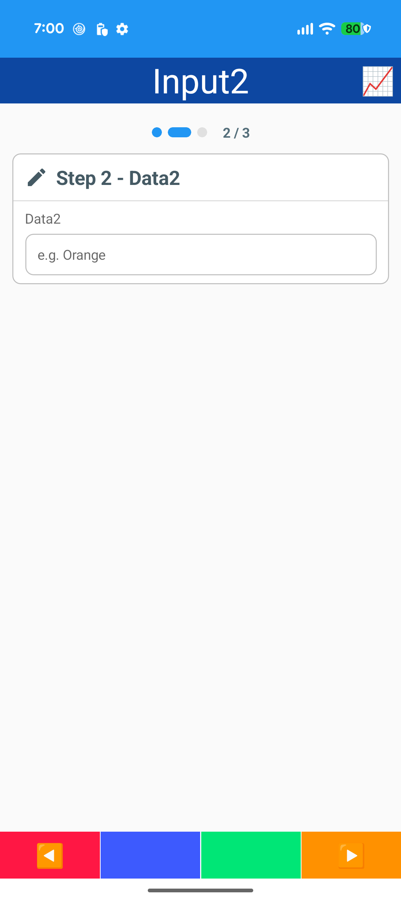
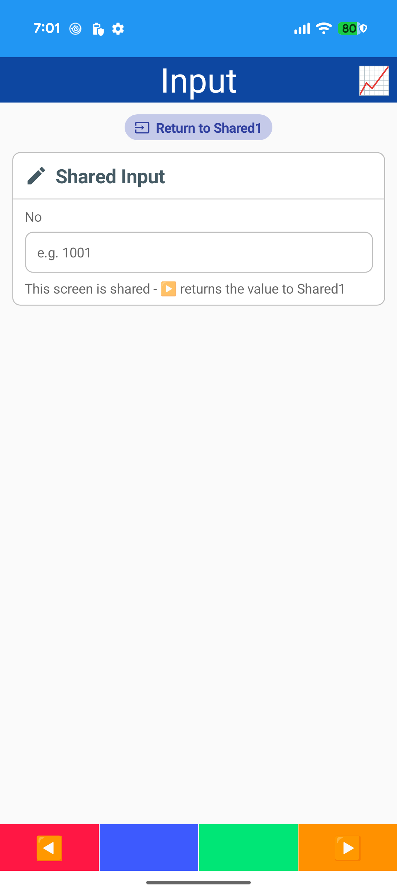
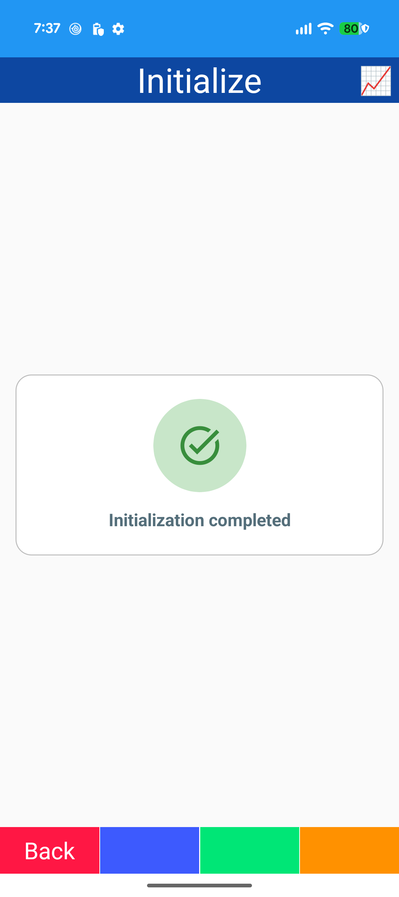
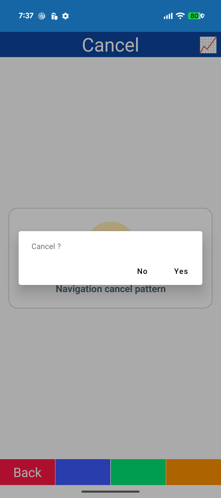
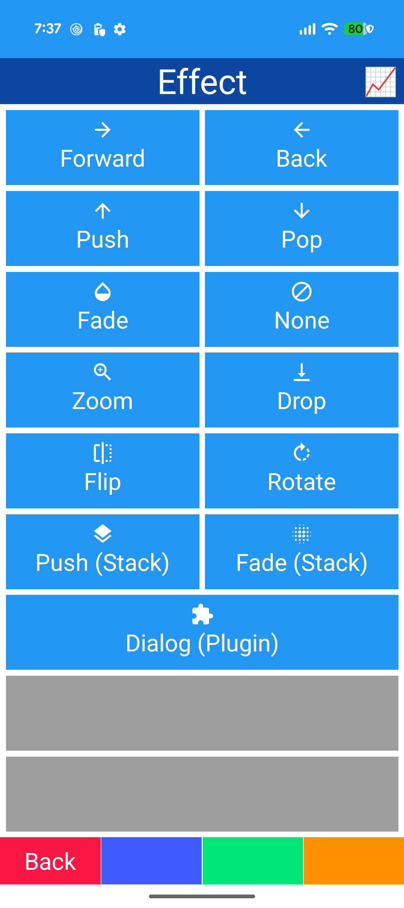
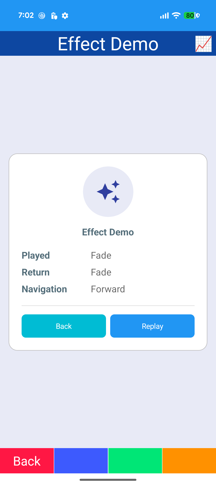
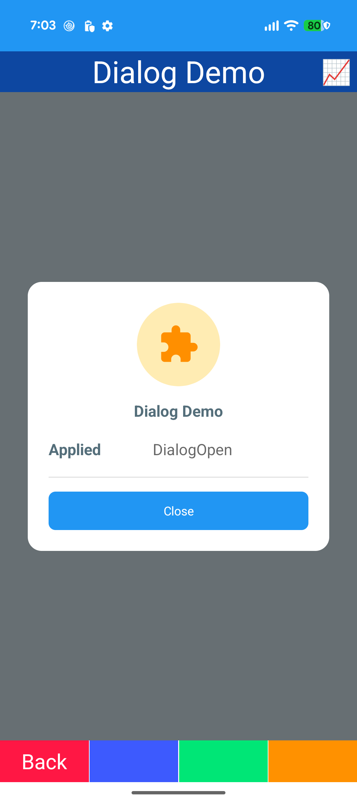

# Navigation

## Edit

- CollectionView (EmptyView / SQLite)
- Row edit / delete buttons
- Multi-select / bulk delete
- NavigationParameter
- Edit screen for New / Update

## Stack

- Stacked navigation (Push / Pop)
- Pop 2 screens
- StepIndicator

## Wizard

- Scope plugin ([Scope] context)
- Next / previous
- Scope lifecycle log
- StepIndicator / summary card

## Shared

- Shared input screen
- Named NavigationParameter
- Parameters helper
- StatusChip

## Initialize

- Initialization after arrival
- BusyState / IDialog.Loading
- Skeleton placeholder

## Cancel

- Confirm dialog on arrival
- BusyState
- Back key

## Dialog

- Popup (IPopupNavigator)
- Number keypad
- Typed parameter / result
- CommunityToolkit Popup

## Effect

- Navigation effects: slide / fade / zoom / drop / flip / rotate
- IMauiNavigationEffect
- Effect with stacked navigation
- Reverse effect on Back
- Dialog-style screen ([DialogView])
