# Device

## Info

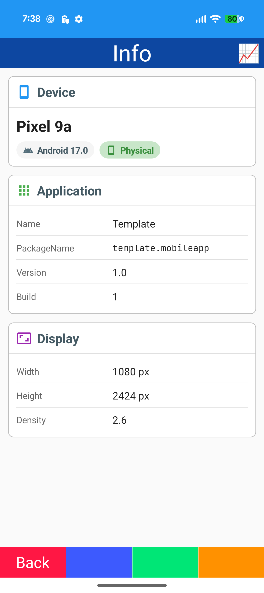

- IDeviceInfo / IAppInfo / IDeviceDisplay
- InfoCard
- StatusChip
- Fade-up entrance

## Status

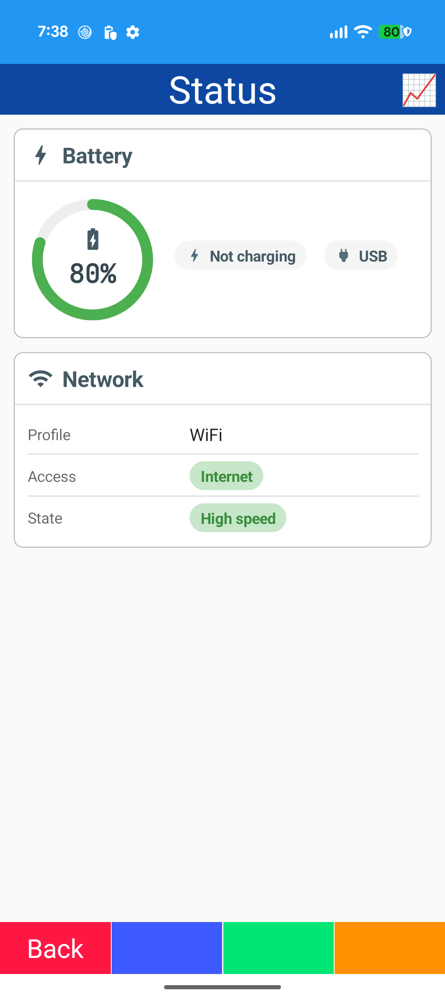

- Battery / network state (DeviceState)
- ArcMeter
- StatusChip
- Battery icon (MultiBinding)

## Sensor

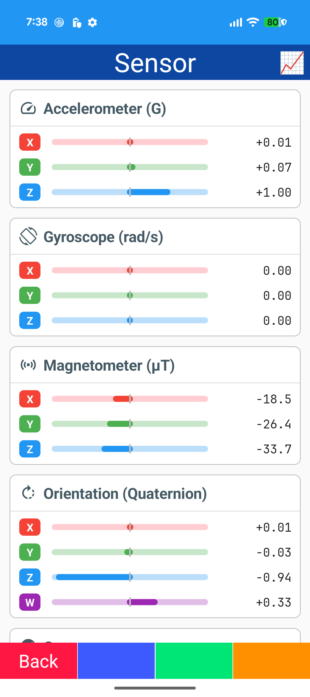
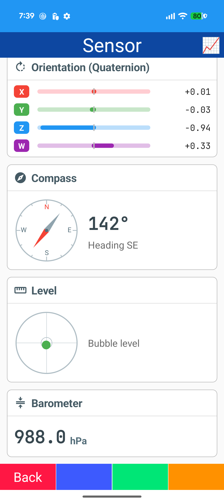

- Accelerometer / Gyroscope / Magnetometer / Orientation / Compass / Barometer
- Rx observables
- RangeBar
- Compass dial / bubble level (GraphicsView)

## Location

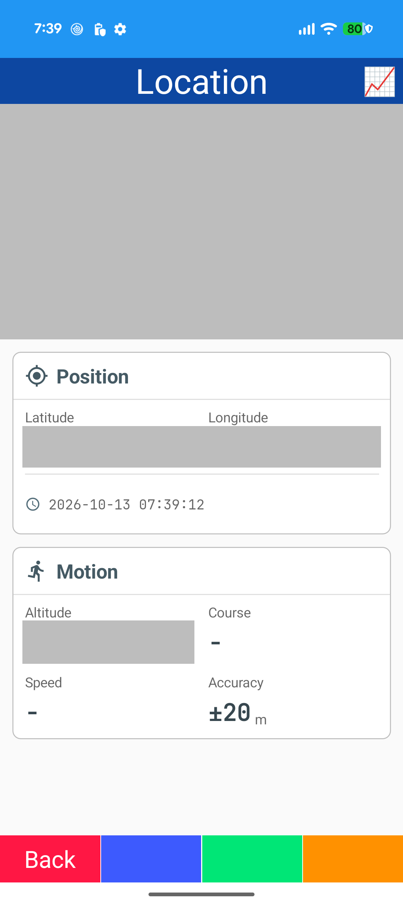

- Map (Microsoft.Maui.Controls.Maps)
- ILocationService
- Position / motion cards
- Ripple empty state
- Google Maps API key

## QR Display

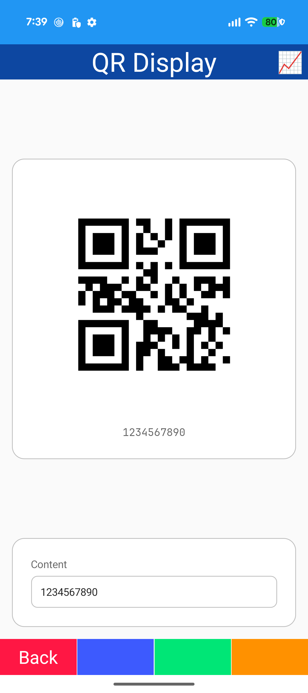

- QRCoder
- Entry
- Fade-up cards

## QR Scan

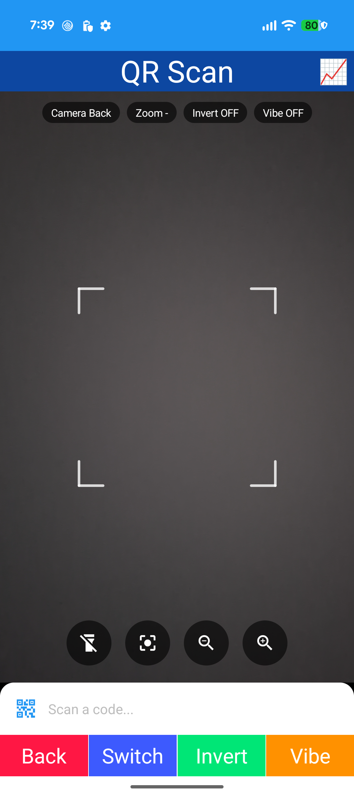

- CameraView (BarcodeScanning.Native.Maui / ML Kit)
- BarcodeBind.Controller
- Detection boxes (GraphicsView)
- Scan frame overlay
- Torch / zoom / camera switch

## Camera

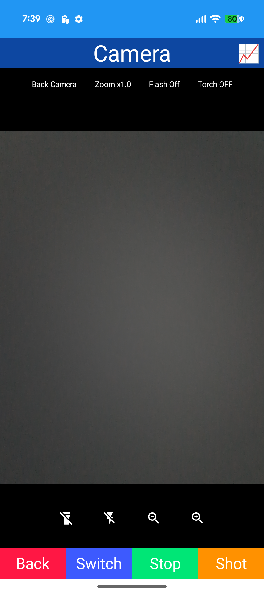

- CameraView (CommunityToolkit.Maui.Camera)
- CameraBind.Controller
- Preview / capture
- Flash / torch / zoom
- State chips

## OCR

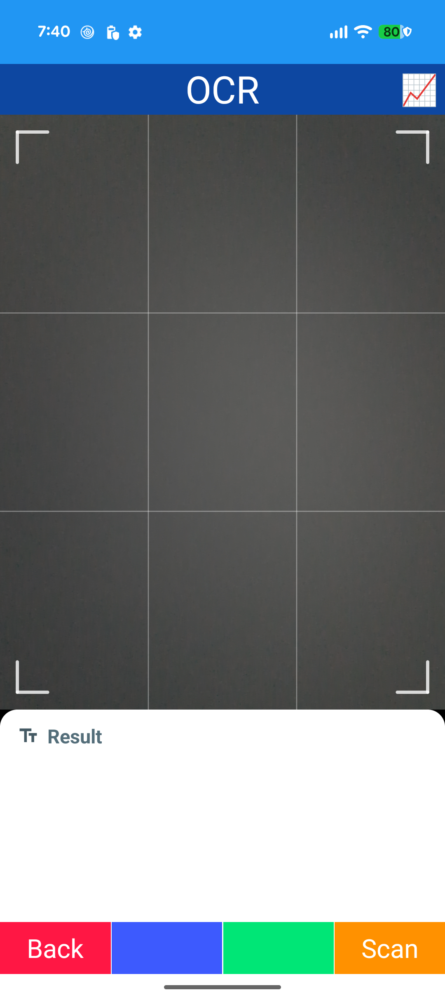

- CameraView
- Guide overlay
- Text recognition (ML Kit / IOcrReader)
- Result panel

## WiFi

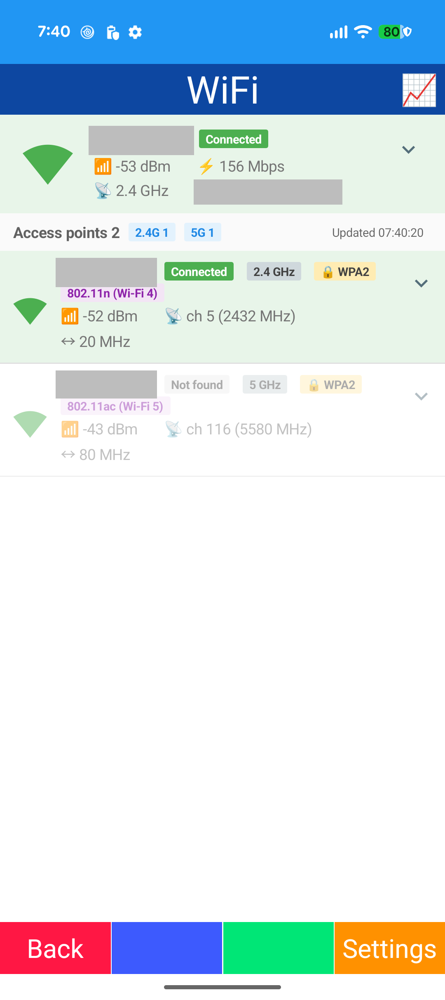

- IWiFiManager
- Expandable connection block
- Access point list (signal icon / chips)
- Auto scan
- Permissions

## Bluetooth

- Bluetooth Classic serial (SPP)
- BluetoothSerialFactory
- Print state (StatusChip / StepIndicator)
- Pulse / wave animation

## BLE Scan

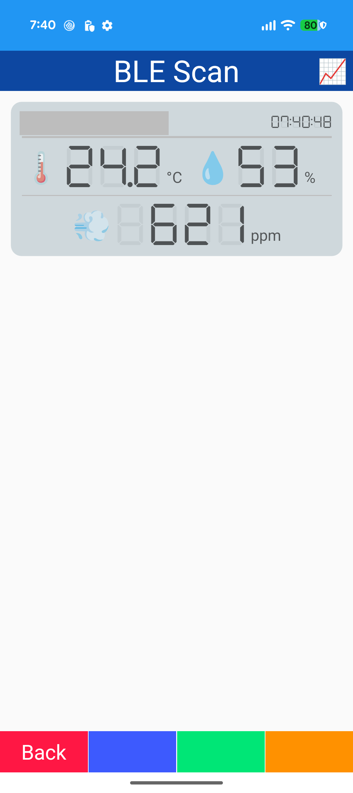

- Shiny.BluetoothLE scan
- SwitchBot readings
- Seven-segment values (DSEG7)
- Bounce on change

## BLE Host

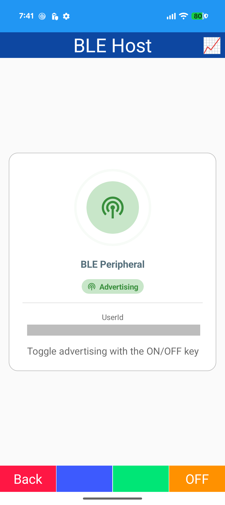

- Shiny.BluetoothLE.Hosting
- GATT service / advertising
- Ripple rings
- StatusChip

## NFC

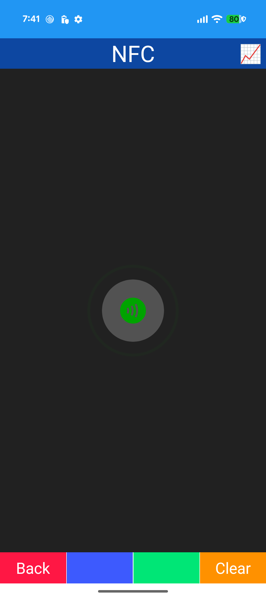

- NFC reader mode (FeliCa)
- Suica balance / history
- Count-up number
- Ripple empty state

## Audio

- Plugin.Maui.Audio
- Play / pause / stop
- Seek slider / volume slider
- Cover art pulse
- Haptic feedback

## Activity

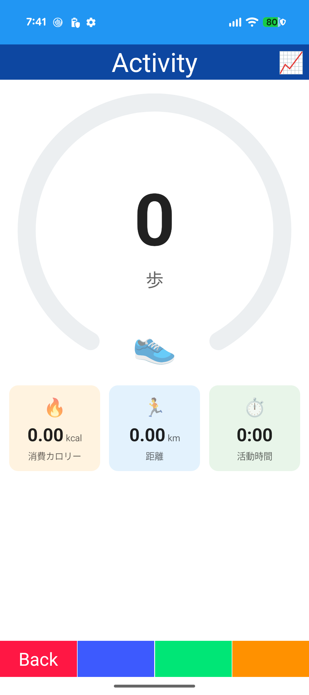

- Step counter (SensorManager)
- Distance / calories / time
- Progress ring (Microsoft.Maui.Graphics)
- Count-up number

## Biometric

- BiometricManager / BiometricPrompt
- Strong / Weak / PIN
- Keystore EC key (StrongBox)
- Signature verification (in-app server)

## Communication

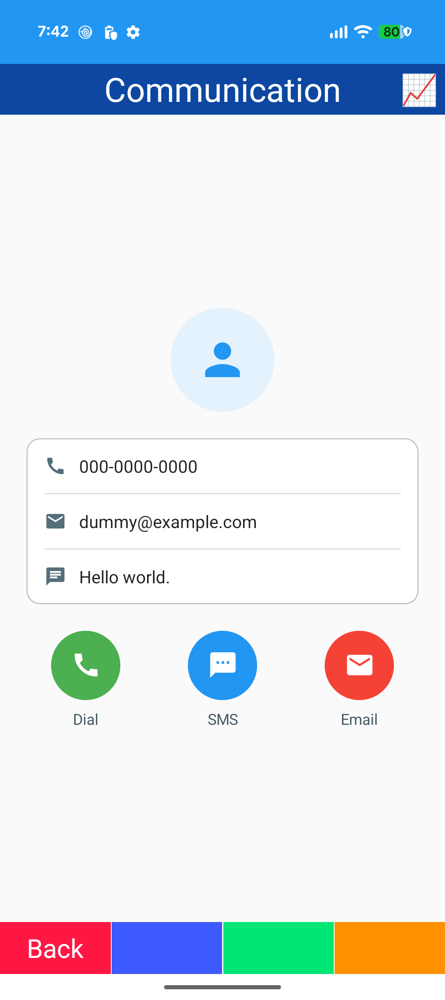

- Phone dialer / SMS / email
- IsSupported
- Manifest queries
- Round buttons

## Misc

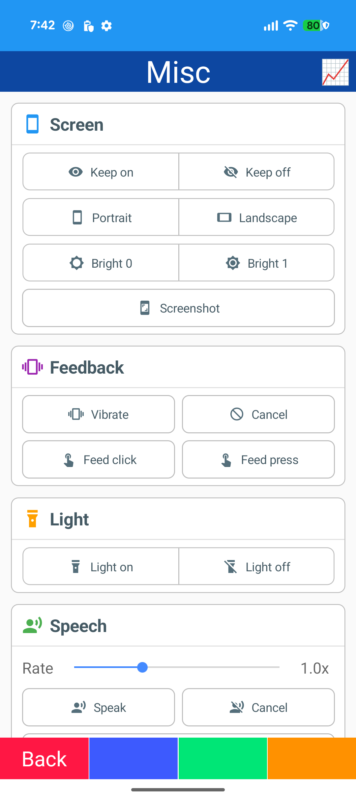
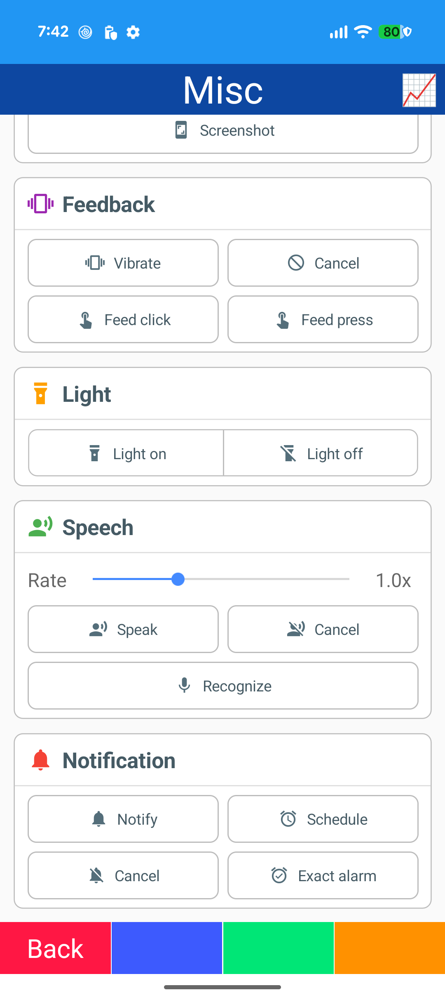

- Screen: keep awake / orientation / brightness / screenshot
- Vibration / haptic feedback / flashlight
- Text to speech / speech to text
- Notifications: immediate / scheduled / action buttons
- Segmented buttons
