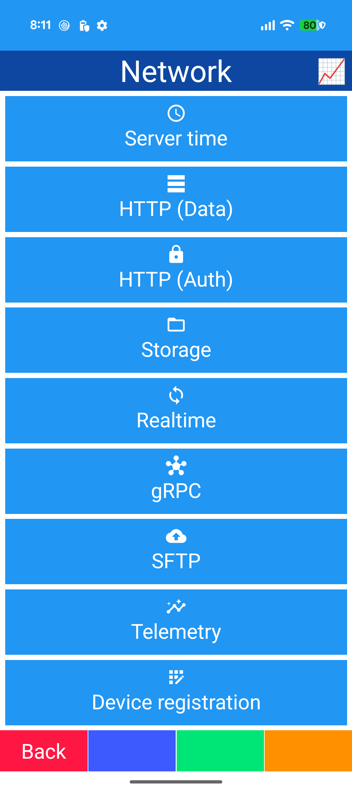
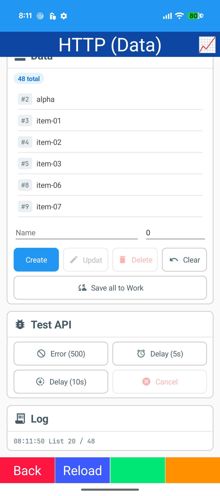
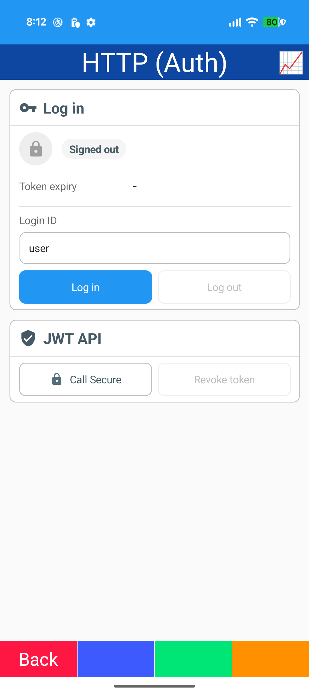
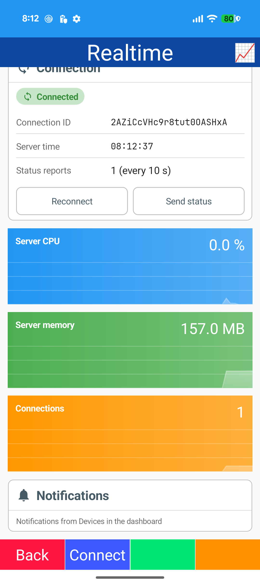
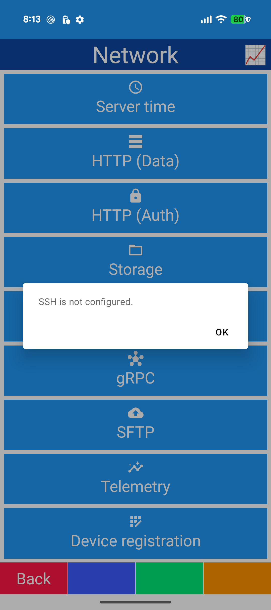

# Network

## Menu

- MenuGrid / MenuIconButton
- Not-configured dialog
- Server time / device registration (Rester)
- Busy indicator

## HTTP (Data)

- Rester / System.Text.Json
- CRUD
- CollectionView (selection / EmptyView / incremental loading)
- Retry dialog / busy indicator
- Test API card / Log card

## HTTP (Auth)

- JWT login
- ApiContext / ApiDelegatingHandler
- Signed in / out StatusChip
- Secure call / revoke token

## Storage

- Directory browser
- Upload / download (FilePicker / MediaPicker)
- Progress / cancel
- Delete confirm / Log card

## Realtime

- Mofucat.ReactiveHub (SignalR)
- StatusChip
- StatControl graphs: CPU / memory / connections
- Device status report
- Local notifications

## gRPC

- Grpc.Net.Client
- Bidirectional streaming chat
- Reconnect (backoff)
- Unary call (server time)
- StatusChip

## SFTP

- SSH.NET SftpClient
- Upload / download / progress / cancel
- Log card
- Screenshot: not-configured dialog

## Telemetry

- OpenTelemetry: traces / metrics / logs (OTLP/HTTP)
- Span / log / flush
- CrashReport
- Custom gauges
- Resend buffer
