# View

## Layout

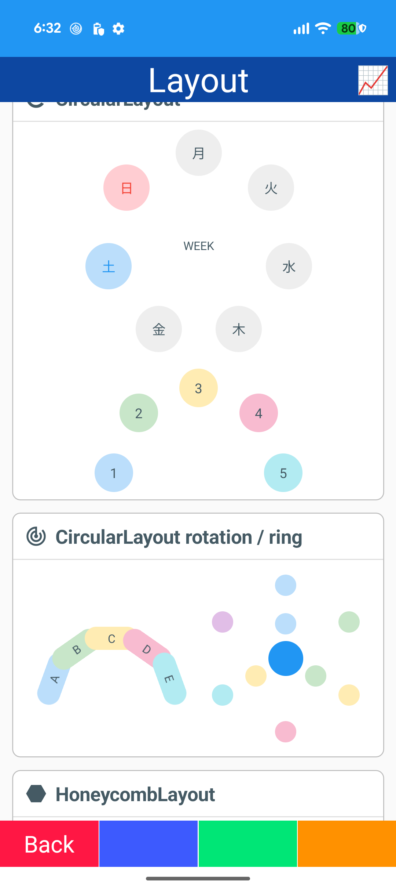
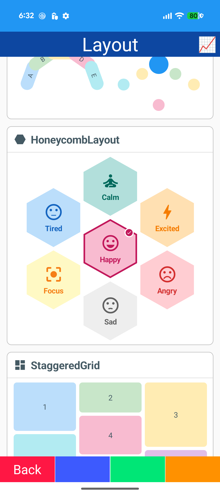
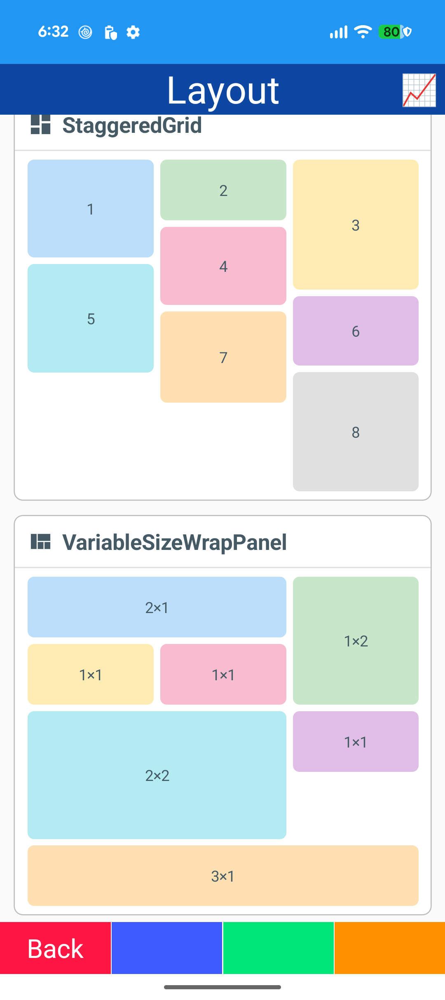
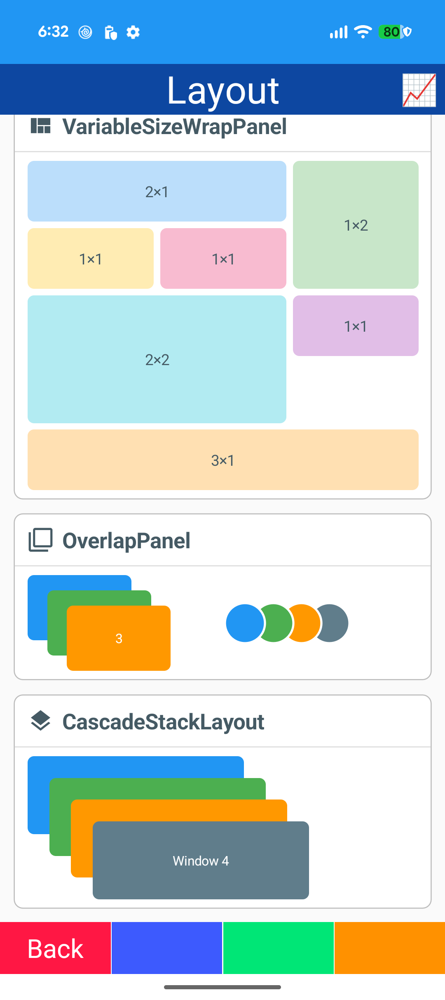

- DockLayout / UniformItemsLayout
- CircularLayout / HoneycombLayout / CascadeStackLayout
- StaggeredGrid / VariableSizeWrapPanel / OverlapPanel
- ILayoutManager

## State

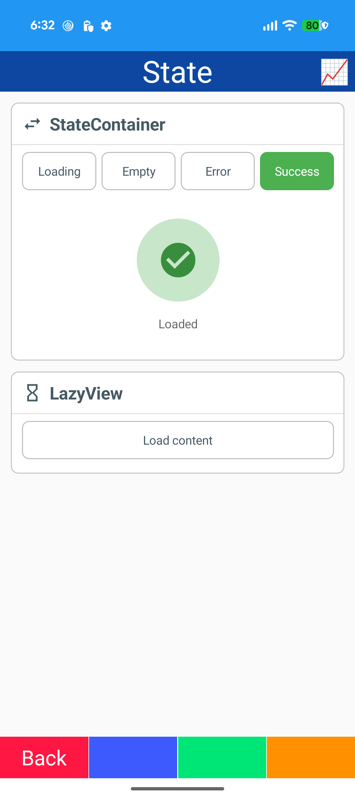

- StateContainer (Loading / Empty / Error)
- LazyView
- Fade-up

## Border

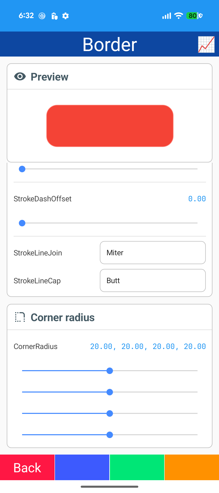

- Border (StrokeShape / stroke / corner radius)
- Picker / Slider
- Color pickers

## Shadow

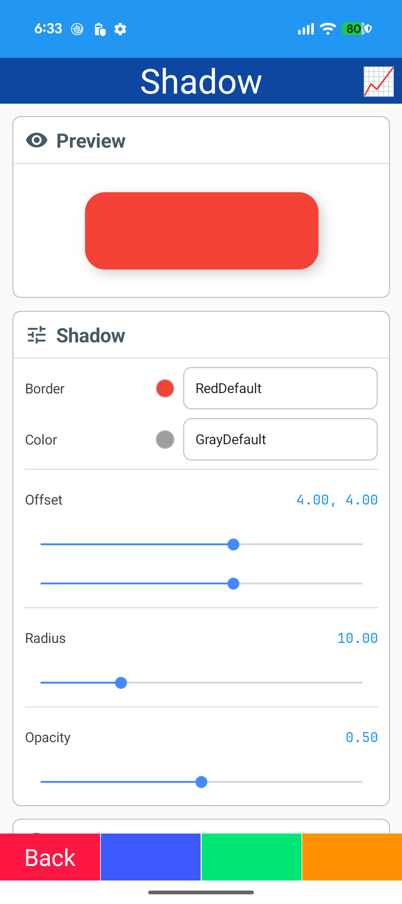
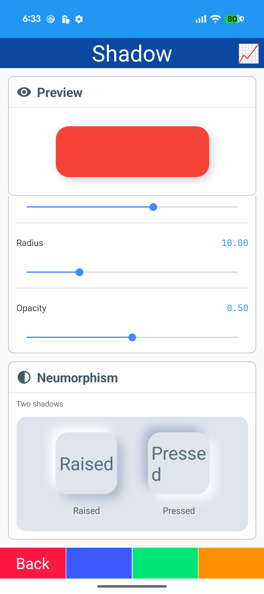

- Shadow (offset / radius / opacity / color)
- Sliders / color pickers
- Neumorphism card

## Animation

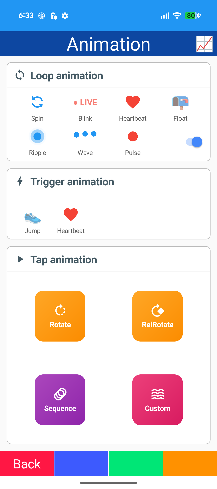

- EventActionBehavior (fade / rotate / scale / shake)
- TapActionBehavior / SpringAnimation
- Loop animations: spin / blink / heartbeat / float / ripple / wave / pulse
- Trigger animations

## Easing

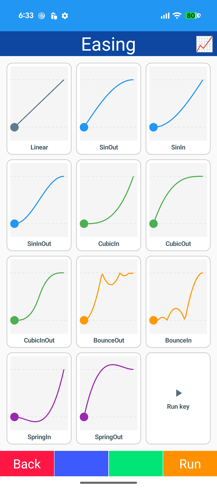

- Easing functions
- GraphicsView curves
- EventRequest

## Effect

- Entrance animation (fade-up / pop)
- Count up
- Focus border
- Press effect / ripple
- Bounce / highlight / flash
- Confetti / long press / icon tint

## Drag & Drop

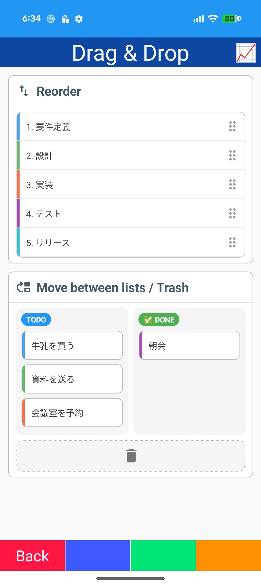

- Drag / Drop gesture recognizers
- Reorder list
- TODO / DONE lists
- Trash cell
- DataTrigger highlight

## Bottom Sheet

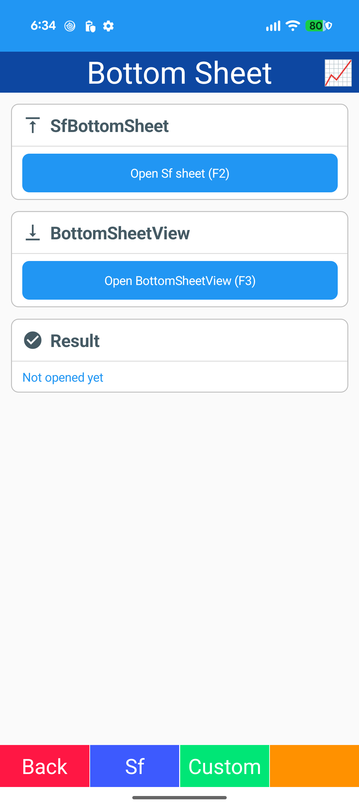
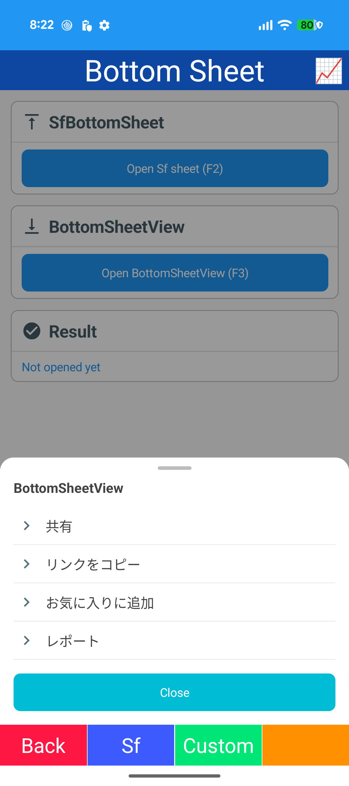

- SfBottomSheet (Syncfusion)
- BottomSheetView
- Half-expanded / expanded
- Action rows (MapToText / MapToColor)

## Drawer

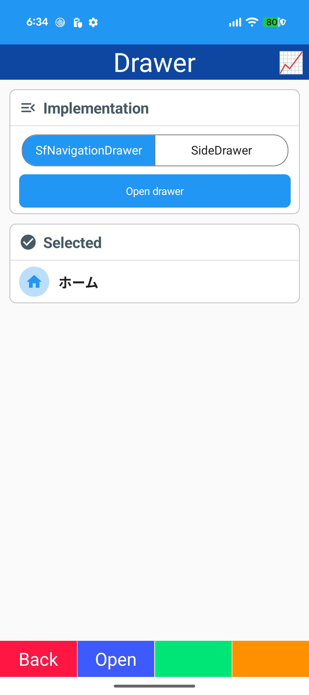
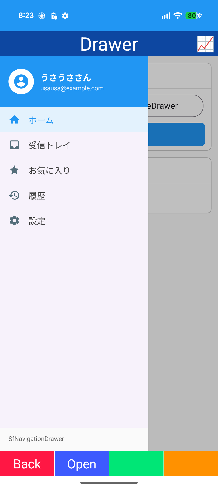

- SfNavigationDrawer (Syncfusion)
- SideDrawer
- SfSegmentedControl
- Menu rows

## Graphics

- Microsoft.Maui.Graphics (GraphicsView)
- Shapes
- Sketch / PNG export
- Pulse ring / countdown arc

## Drawing

- DrawingView (CommunityToolkit.Maui)
- DrawingBind.Controller
- Color chips / width slider
- Save (SkiaSharp)

## Lottie

- SKLottieView
- Seek slider / play / pause
- Scroll-linked playback
- Press-and-hold playback

## SVG

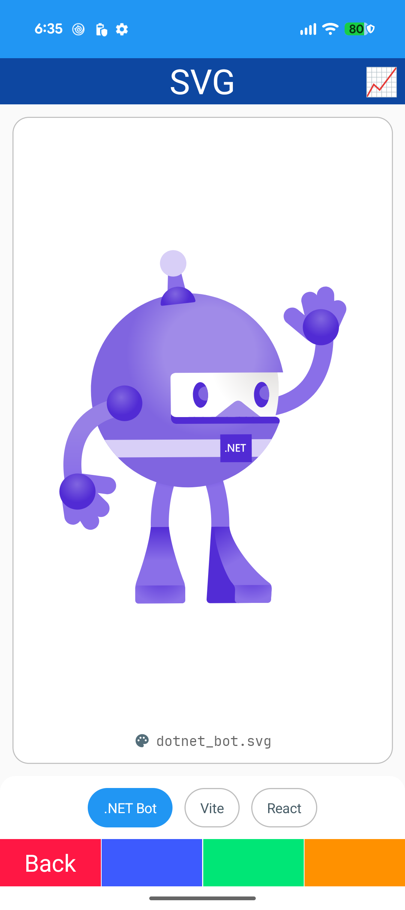

- SvgView (Svg.Skia)
- Placeholder / cache
- Chip buttons

## Toolkit

- SfTabView (Syncfusion)
- SfOtpInput / SfSegmentedControl / SfChipGroup
- AvatarView / RatingView / Expander
- SfAccordion

## Custom

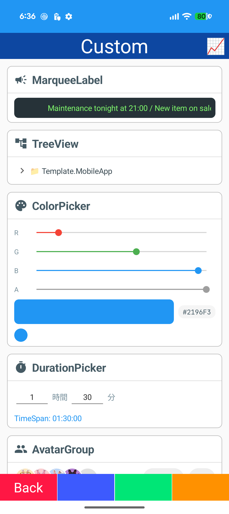

- MarqueeLabel
- TreeView
- ColorPicker / DurationPicker
- AvatarGroup

## Chart

- ChartDrawing: Line / Bar / Donut / Candle / Stacked / Scatter / Heat
- Draw-in animation
- Tap tooltip

## Sf Chart

- Syncfusion Cartesian / Circular / Polar charts
- Funnel / Pyramid
- Spark charts
- Sunburst
