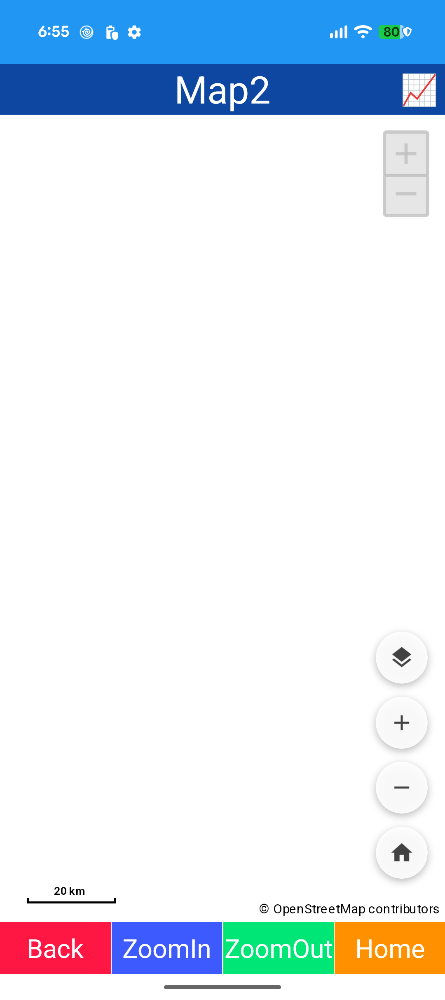
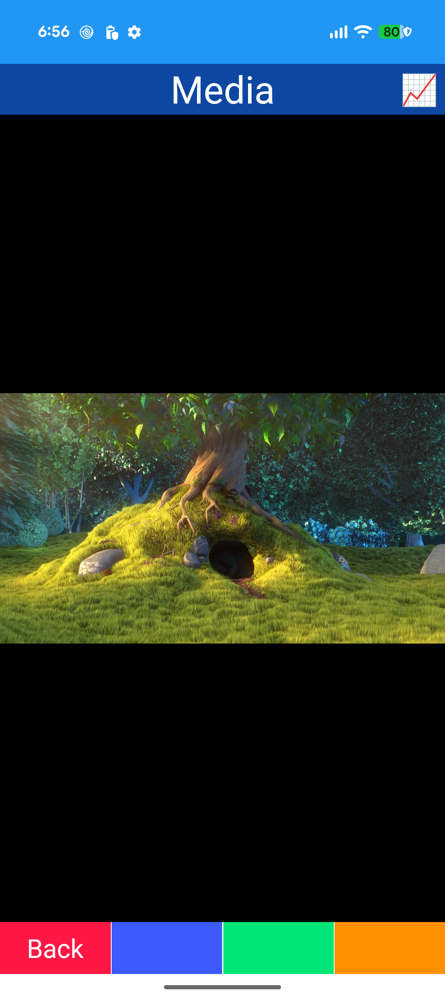
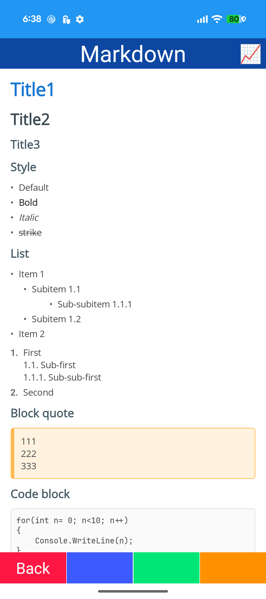
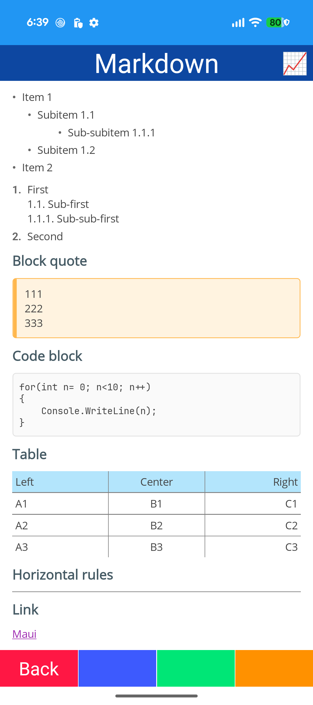
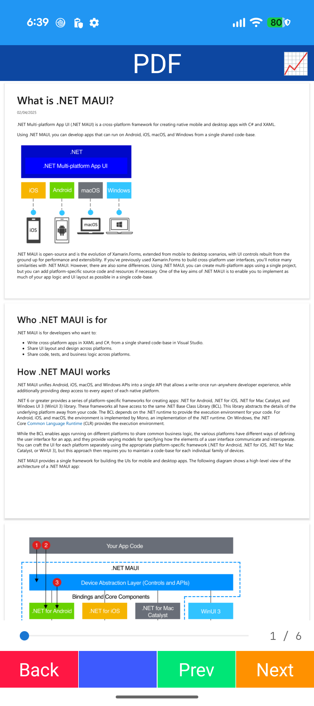
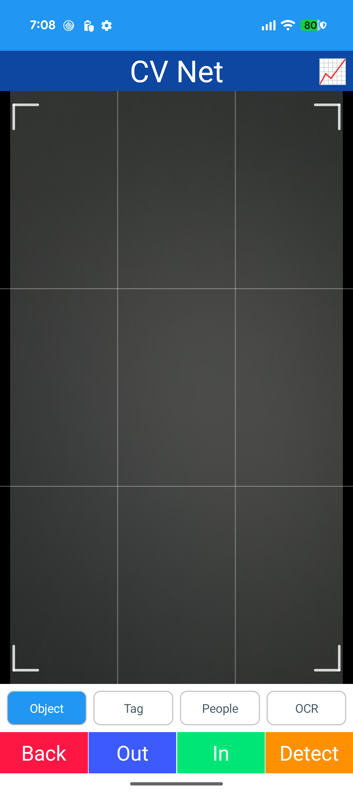
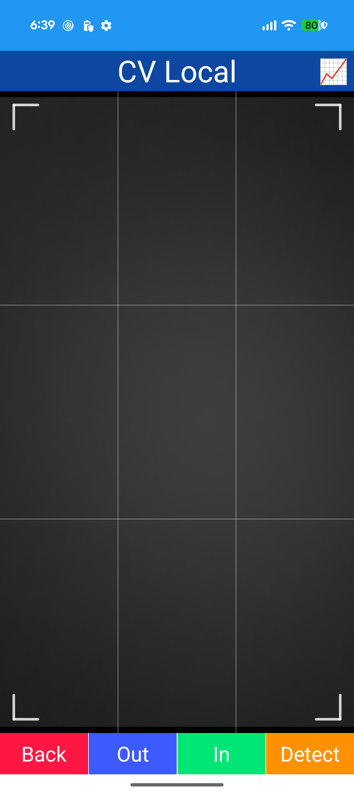
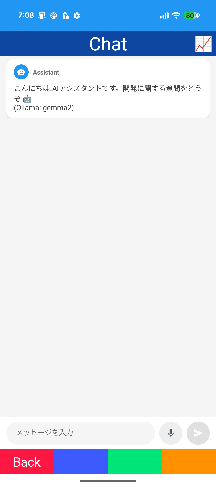

# Sample

## Web Basic

- HybridWebView
- JavaScript / C# messaging (InvokeDotNet / InvokeJavaScriptAsync)
- WebResourceRequested
- WebViewBind

## Web App

- HybridWebView
- Vite + React app
- HybridRoot / DefaultFile

## Map

- Map (Microsoft.Maui.Controls.Maps / Google Maps)
- Pins
- Polyline / Polygon / Circle
- MapBind / MapController
- BottomSheetView

## Map2

- Mapsui (OpenStreetMap)
- MapsuiBind / MapsuiController
- Widgets / spots / shapes / GeoJSON / clusters
- Layer sheet
- SkiaSharp overlay

## Media

- MediaElement
- Custom control bar
- MediaBind / MediaController

## Markdown

- MarkdownView
- Heading / list / quote / code / table / link
- Style mapping

## PDF

- PdfView
- Page slider / label
- Edge buttons
- PdfOption.UseCustomMapper

## CV Net

- CameraView (CameraBind)
- Azure AI Vision
- Object / Tag / People / OCR
- DetectDrawing
- Capture state

## CV Local

- CameraView
- ONNX Runtime
- Object detection
- DetectDrawing

## Chat

- ChatView
- OllamaSharp / IChatClient
- Streaming response
- Typing indicator
- Voice input

## Crop

- CropDrawing (Microsoft.Maui.Graphics)
- IInteractiveDrawing
- PNG export
