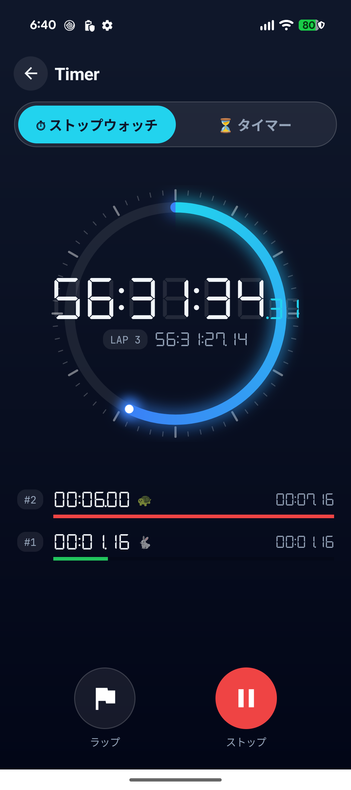
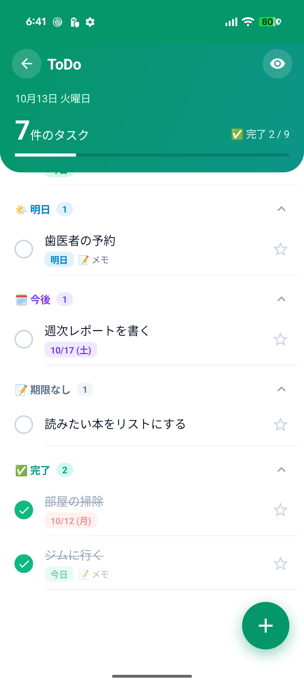
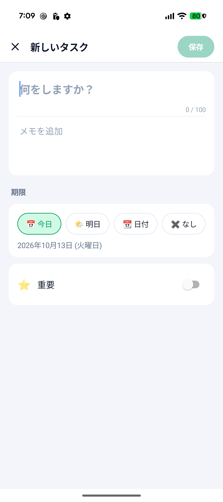
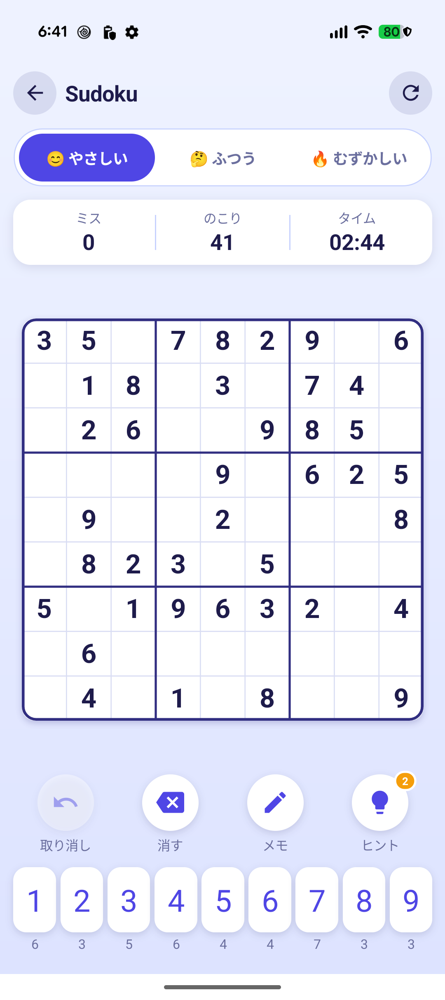
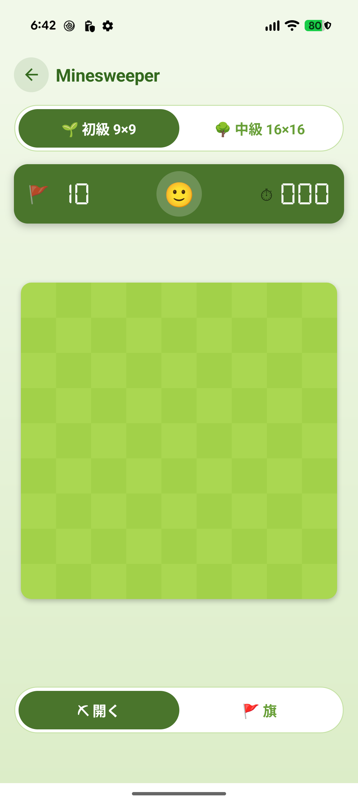

# App

## Calculator

- Keypad Grid
- Shared command
- Expression engine (RPN)
- Result error handling
- DSEG7 display

## Timer

- Stopwatch / countdown
- TimerDial (SkiaSharp)
- DSEG7 readout
- Lap list
- Preset chips / number pad popup
- Notification

## ToDo

- Gradient header
- Grouped CollectionView
- Collapsible groups
- SwipeView delete / undo
- Edit screen (dialog-style Push / Pop)
- SQLite (Smart.Data.Accessor)

## Sudoku

- SudokuBoard (SKCanvasView)
- Notes / hints / undo
- Animations
- Puzzle generator
- JSON save

## 2048

- Puzzle2048Board (SKCanvasView)
- Tile animations
- Swipe / D-pad
- JSON save

## Minesweeper

- MinesweeperBoard (SKCanvasView)
- Long-press flag
- Reveal animation
- Two levels
- JSON best times
- Vibration
