# Main

## Menu

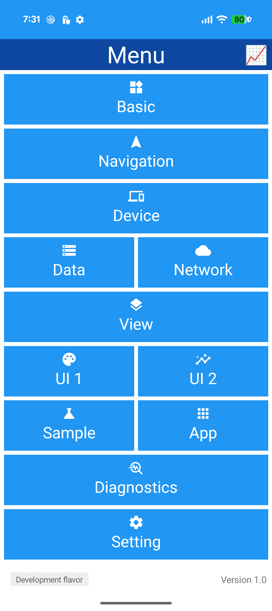
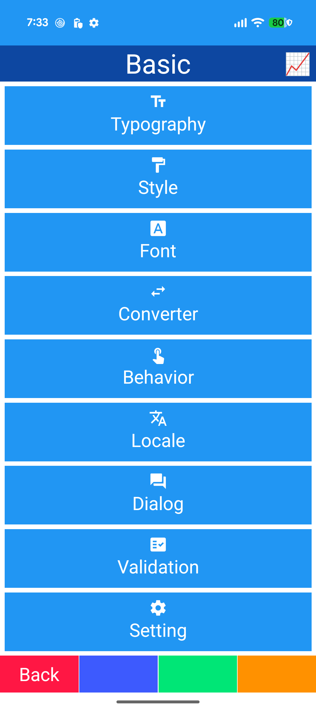
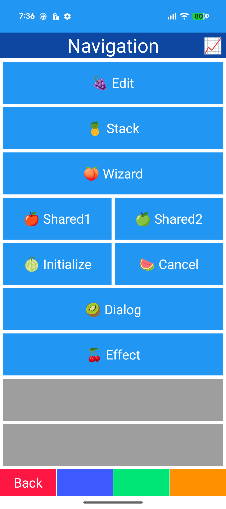
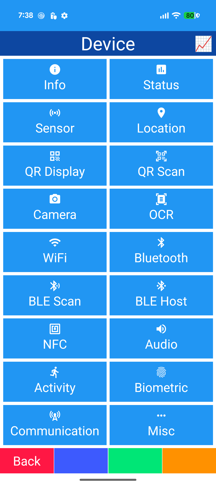

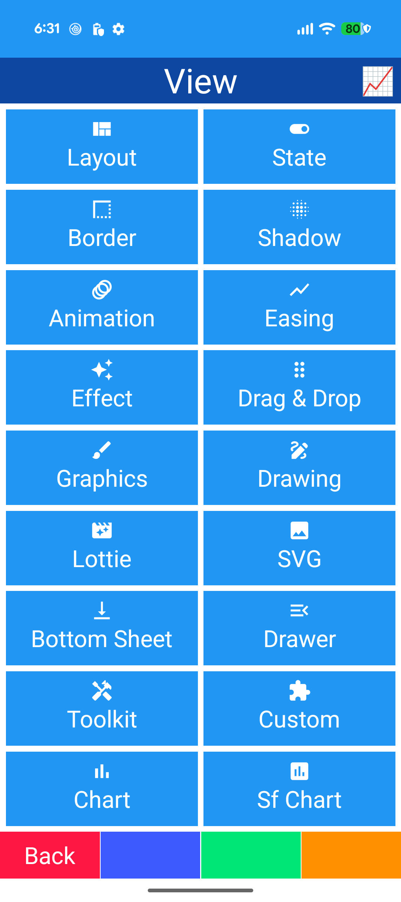
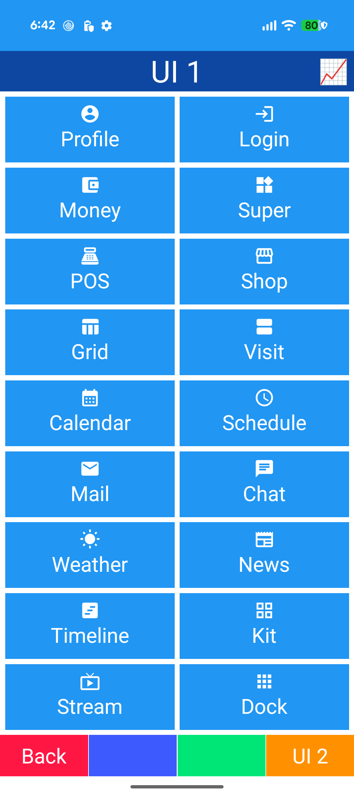
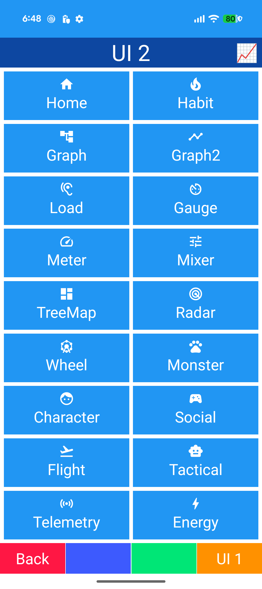
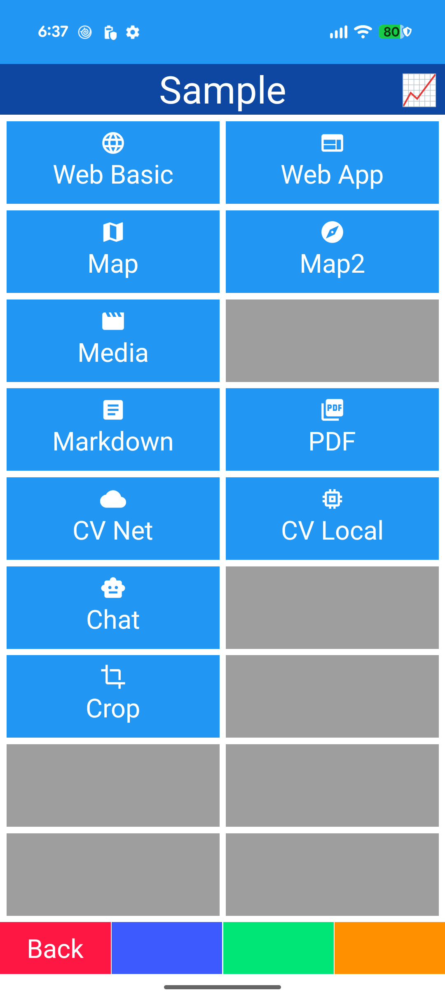
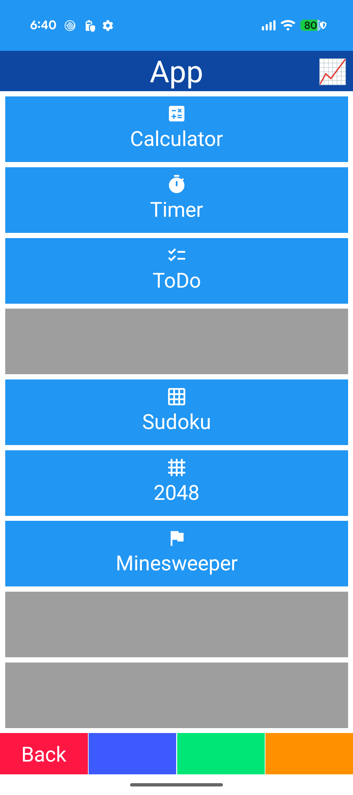

- MenuGrid
- MenuIconButton / MenuButton
- AppIcons
- Footer (flavor / version)
- ViewId navigation
- Not-configured dialog

## Shell

- Header / view container / function keys
- ShellProperty / ShellUpdateBehavior
- ShellEvent (Back / Function1-4)
- BusyState / overlay
- Loading cover
- DiagnosticPanel (DEBUG)
- [ComponentRegistration] DI

## Setting

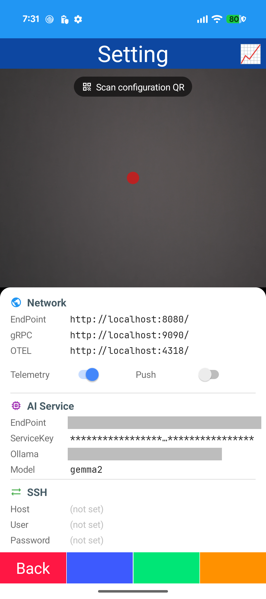

- CameraView QR scan
- BarcodeBind
- SettingParser
- Preferences / SecureStorage
- Masked values
- Telemetry / Push switches

## Diagnostics

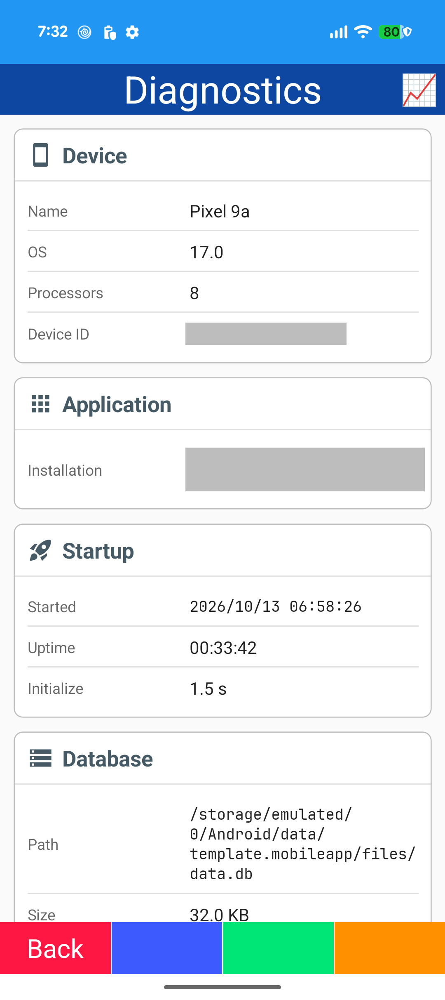
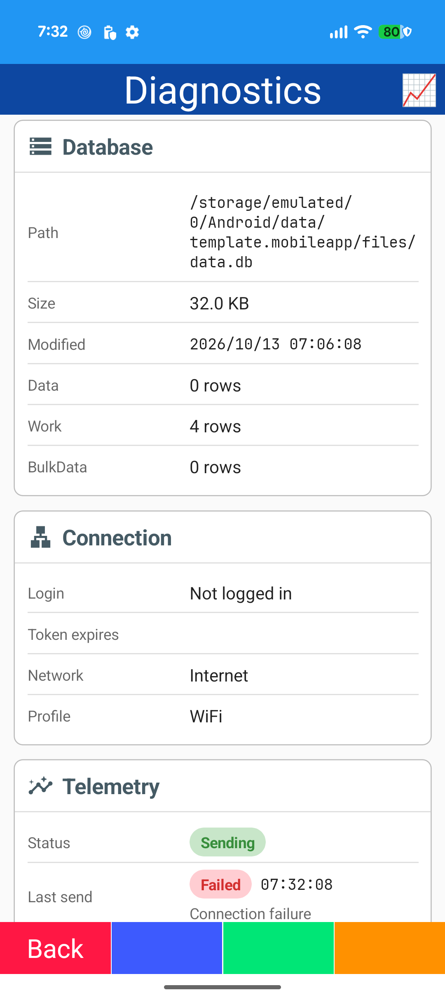

- InfoCard sections
- Device / app / startup / database / connection / telemetry / log / crash
- Timer refresh
- Log share / delete
- Crash report

## Data

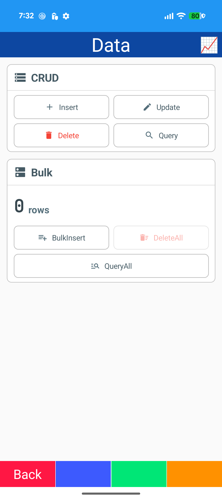

- SQLite
- Smart.Data.Accessor
- CRUD
- Bulk insert (transaction)
- Count-up
